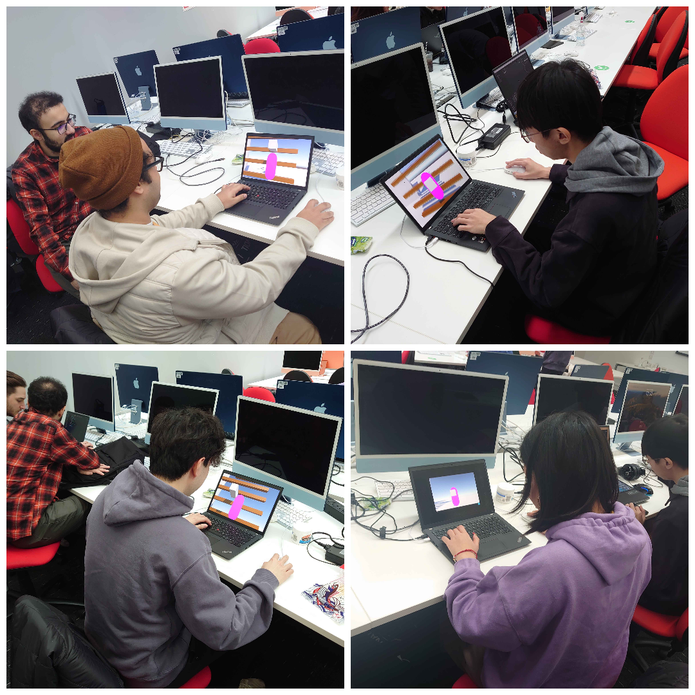

Check out **Texas Klym Em's**
- 💾 [**Game Page**](https://henryha993.itch.io/texas-klym-em)

## About
Texas Klym ‘Em is a western climbing puzzler, where your main point of interaction is grabbing onto things. Grab mode gives you the flexibility to choose your handholds in a climbing route, pick off your pants off from the ceiling or grab a bird. Combining this ability with other navigation mechanics such as jumping allows you parkour across the map.

<iframe width="560" height="315" src="https://www.youtube.com/embed/mr5r24qyhuk?si=IG5uiben_89XazZT" title="YouTube video player" frameborder="0" allow="accelerometer; autoplay; clipboard-write; encrypted-media; gyroscope; picture-in-picture; web-share" referrerpolicy="strict-origin-when-cross-origin" allowfullscreen></iframe>

The grab mechanic was inspired by traditional bouldering, where each handhold presents a potential solution to a boulder. This direction was also inspired by my desire to explore climbing as a conscious part of play, rather than an automated means of navigation.

## Playtesting
This section details how the project evolved from the early stages of playtesting! Thank you to these lovely people for giving the early version a go.

### Early Version
The initial state of the game had an implementation of the grab mechanic. Using WASD, the player would choose the direction of the grab trigger relative to the player character. Then player would then press LMB to grab. To begin a climb, the player was expected to walk towards a climb-able ledge and press LMB.

### Feedback

Here is some of the feedback I received from that session, and how I responded to them in implementation.

1. **Unintuitive Controls**  
   This was the main feedback I received in playtesting. Grabbing at fixed angles/distances using WASD felt unnatural and limiting. Some mentioned that they expected WASD to lead to a shifting motion, rather than grab detection.

   To address this, I started experimenting with using the mouse delta to move the grab trigger. As I was using LMB to grab already, this felt like a better direction to pursue. However, this led to conflict with the camera controls and I later determined that this movement and camera movement should be mutually exclusive. This would later evolve into what the grab mode is now.

   Moreover, I decided to give the player a shifting motion using WASD. This gave the player more control, allowing for smaller adjustments and better positioning to attempt longer grabs through grab mode.

2. **Unclear Grab-ables and Player Character**  
   Players mentioned that grab-ables were unclear, and were confused at some failed attempts to grab. Many more did not even know what my capsule was doing.

   This was the biggest driver behind using game icons to represent the player character. Players mentioned that some sort of hand indicator would help, with some recommending me to use colours. Since the guidelines mentioned we were allowed to use icons, I thought it would be much cooler to use them to represent different hand states.

   To keep the visuals cohesive, I also used icons to represent some of the pickups and interactables in-game, culminating in the visual style you now see in the final product.

3. **Initiating Climb Unclear**  
   Players were confused on how to begin the climb.

   Since the game is focused on control and handholds, I wanted the player to be the one initiating the climbing. I could have easily band-aided using the LMB click to begin climb using indicators, but I thought the movement was unnatural and different to how the player interacts with the world in/out of climbing.

   When iterating on the grab mode, I wondered how it would feel if I could grab all the time and begin a climb that way. This was by far my favourite idea, and evolved to become the way the player interacts with the world too!

   As it became the game's main gimmick, I thought it would be crucial to teach the player how to use it in a tutorial. This is when I came up with the clothing pickups, where the player dresses themselves.

4. **Limiting Camera**  
   I had great feedback from someone who mentioned that the camera felt limiting, especially when looking for your next handhold.

   This led me to develop a climbing camera mode, which gives the player better visibility of the wall as well as where they are grabbing. It also adds a lot to the overall motion of climbing, and I am very proud of its effect.

## Credits
Music is lovingly done by Clayton Rist. Please play through it to experience Minecraft theme in ragtime.

- **Music** - Clayton Rist

- **Icons** - game-icons.net 